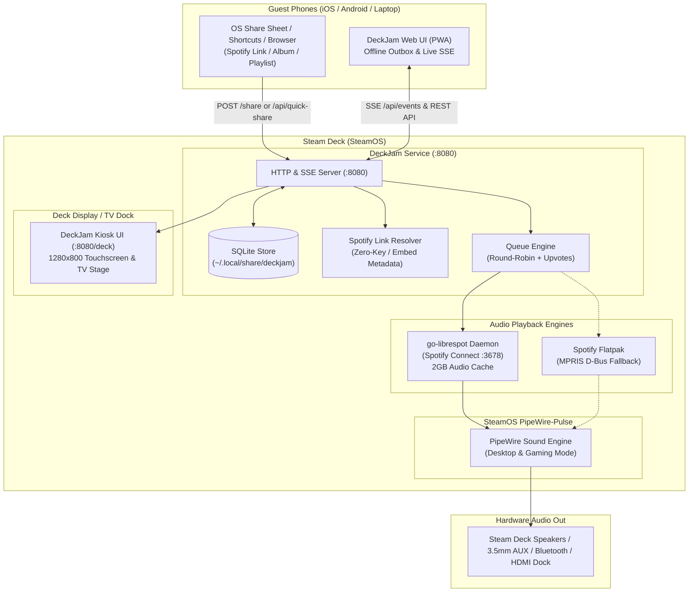

# 🎮 DeckJam

> **Self-hosted, local-first Spotify party jukebox designed specifically for the Steam Deck (SteamOS / Linux).**  
> Guests share Spotify track, album, or playlist links straight from their phone's native OS Share Sheet or mobile browser over local Wi-Fi or an offline Steam Deck hotspot. Queue state lives **100% locally in SQLite**, so spotty road-trip internet or phones dropping off Wi-Fi will never lose your queue or kick your friends out.

---

## 💡 Why DeckJam?

Spotify Jam is great when everyone has a perfect fiber connection and everyone has the Spotify app open. But in reality—on road trips, campsite tailgates, house parties, or hotel rooms:
- **Spotify Jam kicks participants out** the second cellular reception dips.
- **Queue state lives in Spotify's cloud**: if the host drops connection, the entire party queue evaporates.
- **Guest friction**: Friends don't want to install apps, authenticate third-party services, or struggle with invite links.

### How DeckJam Solves This
1. **100% Local-First SQLite Queue**: All tracks, rounds, upvotes, and party history persist on your Steam Deck's local storage (`~/.local/share/deckjam/deckjam.db`).
2. **Offline Outbox & Resilient Resolving**: If a friend queues a song while passing through a dead zone, it queues immediately into SQLite with a local placeholder and enriches metadata as soon as data returns.
3. **2GB Local Audio Cache**: Powered by `go-librespot`, downloaded audio tracks are cached locally on the Deck with LRU eviction. Replayed party anthems buffer instantaneously without consuming mobile hotspot data.
4. **Zero Track Uploads**: Guests only share standard Spotify links (`spotify:track:...` or `https://open.spotify.com/track/...`).
5. **Steam Deck Tailored Audio**: Uses PulseAudio / PipeWire user-space output so audio works seamlessly in both **Gaming Mode** and **Desktop Mode** without locking the ALSA soundcard away from games.

---

## 🏛️ System Architecture



---

## 🚀 Quick Start (Steam Deck 1-Command Turnkey Setup)

DeckJam installs completely in **user space** (`~/.local/bin`, `~/.config`, `~/.local/share`). It **never requires root** or `sudo`, and survives SteamOS system updates intact.

### 1. One-Click Turnkey Launch (`./go.sh`)

Switch to **Desktop Mode** on your Steam Deck (or SSH into it), open the terminal (**Konsole**), and run:

```bash
git clone https://github.com/marcelkornblum/deckjam.git ~/deckjam
cd ~/deckjam
./go.sh
```

What `./go.sh` automatically does:
- Installs or unpacks the prebuilt static binary (`bin/deckjam-linux-amd64.gz`).
- Downloads `cloudflared` for automatic HTTPS Quick Tunnels (`https://*.trycloudflare.com`) so phones on your **iPhone / Android Hotspot** or across the room can join without manual port-forwarding or local subnet headaches!
- Downloads and launches `go-librespot` with PipeWire audio output and a 2GB persistent audio cache.
- Installs and enables `systemd --user` background services (`go-librespot.service`, `deckjam.service`, `deckjam-tunnel.service`).
- Creates a `DeckJam Jukebox` desktop shortcut and registers it with Steam Gaming Mode (`steamos-add-to-steam`).
- Displays a crisp, high-density **scannable terminal QR code** directly in your console!

### 2. Pair Spotify in 1 Tap

1. Point your phone camera at the terminal QR code (or open the displayed Join URL).
2. Look at the high-visibility **"Step 1: Connect Spotify"** banner at the top of the mobile UI.
3. Tap **"Pair Spotify in 1 Tap &rarr;"** — Spotify authenticates your account in one tap via `spotify.com/pair`!
4. The banner automatically disappears, and DeckJam immediately promotes `librespot` to active playback!
3. Start playing any song, tap the **Devices** icon (Spotify Connect), and select **"Steam Deck Jam"**.
4. That's it! Because `persist_credentials: true` is configured, your Deck will remain authenticated across reboots.

### 3. Add to Gaming Mode

If `steamos-add-to-steam` was present during install, **DeckJam Jukebox** is already in your Steam library under **Non-Steam Games**.

To launch manually in Gaming Mode:
- Select **DeckJam Jukebox** from your Steam Library.
- Hit **Play**. It will launch the 1280x800 fullscreen touchscreen Jukebox view (`http://127.0.0.1:8080/deck`).
- Connect your Deck to your party speaker via 3.5mm AUX, Bluetooth, or USB-C dock!

---

## 📱 Sharing Songs from Phones

Guests do not need to install an app from an app store. They just join the Wi-Fi and use their favorite method below:

### 1. Android Native OS Share Sheet
- **Via PWA (Recommended)**: Open `http://<deck-ip>:8080` in Chrome/Brave on Android and tap **"Add to Home screen"** or **"Install"**. DeckJam registers as an Android Web Share Target. In Spotify, tap **Share** -> select **DeckJam** -> song is instantly queued!
- **Via HTTP Shortcuts App**: Import the ready-to-use shortcut generated directly by your Deck at:
  ```
  http://<deck-ip>:8080/api/shortcuts/http-shortcuts.json
  ```
  Tap **Share** in Spotify, choose **HTTP Shortcuts**, and the song is silently enqueued in background.

### 2. iPhone (iOS) Share Sheet via Apple Shortcuts
1. On iPhone, open the **Shortcuts** app and create a simple 2-action shortcut:
   - **Receive**: Any input from Share Sheet.
   - **Get Contents of URL**:
     - URL: `http://<deck-ip>:8080/api/quick-share`
     - Method: `POST`
     - Request Body: JSON with key `url` = `Shortcut Input`.
2. Name it **"Queue to DeckJam"**.
3. In Spotify on iOS, tap **Share** -> **More** -> **"Queue to DeckJam"**!

### 3. One-Tap Mobile Web & Clipboard Paste
- Scan the QR code shown on the Steam Deck's Jukebox screen (`/deck`) or navigate to `http://<deck-ip>:8080`.
- Tap **"Paste Spotify Link"** or type into the search box. Accepts individual tracks, albums, or playlists (enqueues up to 50 tracks in batch).

---

## 🚗 Shaky Internet & Road-Trip Hotspot Mode

When driving through the mountains, camping, or away from a home Wi-Fi router, the Steam Deck can create its own private Wi-Fi network using SteamOS's built-in NetworkManager:

### Start the Hotspot
```bash
~/deckjam/scripts/hotspot-steamdeck.sh start "DeckJam" "steamdeckjam"
```

1. Friends connect their phones to the Wi-Fi network:
   - **SSID**: `DeckJam`
   - **Password**: `steamdeckjam`
2. Friends navigate in Safari or Chrome to:
   - `http://10.42.0.1:8080`
3. Any songs already in the 2GB local cache or added to the **Fallback Playlist** play seamlessly without any internet connection!

### Stop the Hotspot
When you get back home:
```bash
~/deckjam/scripts/hotspot-steamdeck.sh stop
```
The Steam Deck will immediately reconnect to your normal home Wi-Fi.

### Pre-loading a Fallback Pool
To make sure music never stops even in zero-cell-coverage areas:
1. When on home Wi-Fi before your trip, open the mobile UI or Deck UI.
2. Queue up an offline-ready playlist with `target: "fallback"`.
3. Songs will be cached in `~/.cache/go-librespot`.
4. If the guest queue ever runs empty, DeckJam automatically shuffles songs from the Fallback Pool!

---

## 🛠️ CLI Flags & Environment Variables

The `deckjam` binary accepts the following command-line flags and environment variables:

| Flag | Environment Variable | Default | Description |
| :--- | :--- | :--- | :--- |
| `--addr` | `DECKJAM_ADDR` | `0.0.0.0:8080` | Bind address and port for the HTTP/SSE server |
| `--data-dir` | `DECKJAM_DATA_DIR` | `~/.local/share/deckjam` | Directory where SQLite database and cover art cache live |
| `--librespot-url` | `DECKJAM_LIBRESPOT_URL` | `http://127.0.0.1:3678` | URL of the local `go-librespot` management API |
| `--backend` | `DECKJAM_BACKEND` | `auto` | Player backend (`auto`, `librespot`, `mpris`, `mock`) |
| `--host-pin` | `DECKJAM_HOST_PIN` | *(Auto 4-digit PIN)* | 4-digit PIN for host controls from remote devices |
| `--hostname` | `DECKJAM_HOSTNAME` | *(Auto-detected IP)* | Hostname/IP advertised in QR codes and state snapshots |

---

## 🔧 Service Management & Troubleshooting

### Check Background Services
```bash
systemctl --user status deckjam.service
systemctl --user status go-librespot.service
```

### View Live Logs
```bash
journalctl --user -u deckjam.service -f
journalctl --user -u go-librespot.service -f
```

### Restart Services
```bash
systemctl --user restart go-librespot.service deckjam.service
```

### Manual Jukebox UI Launch
```bash
deckjam-ui
# Or directly:
~/.local/share/deckjam/launch-jukebox-ui.sh
```

### Uninstall DeckJam
```bash
~/deckjam/scripts/uninstall-steamdeck.sh
```
To also purge SQLite history, databases, and cached tracks:
```bash
~/deckjam/scripts/uninstall-steamdeck.sh --purge
```

---

## 📄 License
MIT License. Built with ❤️ for the Steam Deck community.
